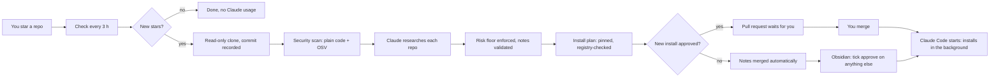

# star-triage

**You star repos. Claude reviews them, and the good ones install themselves.**

Every GitHub user has a pile of starred repos they never looked at again. `star-triage` runs
in your own GitHub Actions. Within a few hours of a new star it:

1. scans the repo with plain code for security risks (hooks, install scripts, hidden
   downloads, obfuscation, vulnerable dependencies and more),
2. has Claude Code research it: README, code, the scan's findings and independent reviews,
3. writes one labelled note per repo and adds it to your tracker, and
4. works out exactly how to install it, whatever it is: a Claude Code **plugin**, **skills**,
   an **MCP server** or a **command-line tool**, pinned to the reviewed commit or to a
   package version that is checked to really come from that repo.

Approved installs then happen **on your computer by themselves**: when Claude Code starts, a
quick background check installs anything new. You approve by merging the review PR, or by
ticking the `approve` box on any note in Obsidian. Untick it and it is removed again. Or turn
on [auto mode](#auto-mode-in-10-seconds) and safe items approve themselves.

Each note answers the questions you actually have:

- What is it, really, under the marketing?
- Does it live up to its claims ("70% fewer tokens", "10x faster")?
- How risky is it to install, with the evidence (file and line)?
- Does it matter for *your* projects?
- Verdict: Install, Try, When needed, Optional, Not now or Skip.

The notes are plain Markdown with properties at the top, so the `tracker/` folder works as an
**Obsidian vault** out of the box and reads fine on GitHub.

**Highlights:** installs plugins, skills, MCP servers and CLI tools by themselves · a scanner
the AI can't argue with · a risk floor Claude can raise but never lower · nothing from a
starred repo runs during review · every install pinned and checked against its repo ·
approve with a merge or a checkbox · runs entirely in your own GitHub.
Full list: [docs/FEATURES.md](docs/FEATURES.md).



## Quick start (about 5 minutes)

You need Claude Code, Python 3.9+, git and a GitHub account. The
[GitHub CLI](https://cli.github.com) (`gh auth login`) lets setup do everything for you.
Commands on this page are written with `python3`. On Windows, type `python` instead.

1. **Install the plugin** in Claude Code:

   ```
   /plugin marketplace add thebeekeper/star-triage
   /plugin install star-triage@star-triage
   ```

2. **Run setup:** type `/star-triage:setup`. Claude checks what you have and gives you one
   command to run in your terminal. That command creates a small private GitHub repo for your
   notes, asks a few questions about you and your projects, lets Actions open pull requests,
   stores your Claude token as a secret, and starts the first run, asking yes/no before each
   step. Your token goes from Claude's login page straight into GitHub's hidden prompt; it is
   never saved or shown to an AI.

3. **After the first run** (2 to 5 minutes; setup prints the link):
   - Check the run is green on your repo's **Actions** tab. A red run says why on its page.
   - Merge the pull request if one is waiting. It only waits when it approves an install;
     notes-only runs merge themselves.
   - Run `git pull` in your new repo folder to get the notes.
   - Open that folder in Obsidian 1.9 or newer (the table views use Bases; see "Daily use").

   From now on, approved installs happen by themselves when Claude Code starts.

**All your existing stars get reviewed**, newest first: `max_per_run` repos per run (8 unless
you change it), one run every 3 hours, until it has caught up. With 200 stars that is about
three days. See [Cost](#cost) to slow it down or leave repos out.

Check your setup at any time with `python3 star-triage.py doctor` in your data repo, or
`/star-triage:setup` in Claude Code. Problems people have hit are in
[Troubleshooting](https://github.com/thebeekeper/star-triage/blob/main/docs/TROUBLESHOOTING.md).

## Auto mode in 10 seconds

One setting decides who approves installs:

| Mode | In plain words |
| --- | --- |
| `manual` | I approve every install (the default) |
| `auto` | Install safe things by themselves (Low risk only) |
| `auto-plus` | Install safe and medium-risk things by themselves (Low and Medium) |

High-risk and blocked items are **never** installed automatically, in any mode.

```
python3 star-triage.py mode
```

shows the current mode and a 1/2/3 menu. `python3 star-triage.py mode auto` switches without
the menu. In Claude Code, say "turn on auto mode" or run `/star-triage:mode`. All three change
`mode` in `config.yml`, commit and push.

In `auto` and `auto-plus`, an item installs only after a 6-hour safety delay from its review
(`auto_wait_hours`), and at most 5 install per day (`auto_daily_limit`). That delay is your
chance to stop one: untick `approve` on its note, or pause.

- `python3 star-triage.py pause` stops everything automatic on this computer; `resume` starts
  it again. Works in every mode.
- `python3 star-triage.py undo` removes everything the last automatic batch installed and
  unticks those notes. It asks first.
- `python3 star-triage.py history` lists the last 20 automatic installs and removals, with the
  reason for each.

### How it fits together

- **This repo is the engine:** a GitHub Action (the cloud side) and a Claude Code plugin (the
  computer side), sharing one copy of the code. Action fixes reach your workflow by
  themselves; the plugin updates when you update it (see the FAQ).
- **Your data repo** is tiny: `config.yml`, your `tracker/` notes, `installs.json`, a launcher
  (`star-triage.py`) and a 20-line workflow that calls `thebeekeper/star-triage@v1`.

<details>
<summary>Set up by hand instead</summary>

1. Create a new private repo on GitHub and copy everything from this repo's `template/` folder
   into it (including `template/.github/`). Edit `config.yml`: write two or three lines in
   `about_me` and list your projects under `contexts`.
2. Add a Claude credential as a repository secret
   (*Settings → Secrets and variables → Actions → New repository secret*):
   `CLAUDE_CODE_OAUTH_TOKEN` (run `claude setup-token`; uses your Claude subscription) or
   `ANTHROPIC_API_KEY`.
3. *Settings → Actions → General → Workflow permissions* → tick **Allow GitHub Actions to
   create and approve pull requests** → Save.
4. *Actions → star-triage → Run workflow*, set "Max repos" to `2`.
5. Install the plugin (step 1 above) and, from your data repo's folder, run
   `python <plugin folder>/scripts/setup.py --skip-config` once to link it. The
   `/star-triage:setup` skill shows the exact path.

</details>

### Upgrading from v4 (a copy with its own `scripts/` folder)

Install the plugin (step 1), then in Claude Code run `/star-triage:setup`: it sees the old
layout and gives you the command (`setup.py --migrate`). It removes the copied code, swaps in
the small workflow and the launcher, and keeps your config, notes, `installs.json` and
approvals. Nothing you installed is reinstalled.

## Daily use

After setup it runs by itself every 3 hours. Your part:

- **Read new notes.** Runs that approve no new installs merge themselves, so notes just appear.
- **Approve installs.** A run that approves an install opens a pull request and waits for you.
  Read the notes (the *Install plan* and *Security scan* sections say exactly what would be
  installed and why), then merge. Until you do, later runs add to that same PR. Want it fully
  hands-off? Switch to auto mode (`python3 star-triage.py mode auto`) and installs rated Low
  risk approve themselves.
- **Or approve in Obsidian.** Every installable note has an `approve` checkbox. Tick it to
  install something Claude rated Try or Optional; untick it to remove something. The
  **Installs** view in `tracker/Star Triage.base` lists them all.
- **Installs happen by themselves:** each time Claude Code starts, the star-triage plugin pulls
  your approvals and installs anything new in the background, then tells you what it did the
  next time. Skills work straight away; plugins and MCP servers load on the next start.
  - `python3 star-triage.py sync` does the same by hand; `--dry-run` shows the plan first.
  - `python3 star-triage.py sync --status` lists everything installable and its state.
  - `python3 star-triage.py sync --uninstall NAME` removes one and unticks its note.
  - You need Node.js for npm-based tools and uv for Python-based ones; `python3 star-triage.py doctor` checks.
- **Review a repo again.** Run the workflow with **retriage** set to a list of `owner/name`.
  Your status and approve choices are kept. A note you wrote by hand never went through the
  scan, so it can't be installed until it is reviewed this way.
- **Triage notes:** change `status` from `Inbox` to `Reviewing`, `Try next`, `Using`, `Later` or
  `Skipped`.
- **Obsidian** (1.9 or newer, for Bases): open your clone (or just `tracker/`) as a vault, then open
  `tracker/Star Triage.base` for the Inbox, All repos, Try next, Installs and Cards views.
  To see new notes without running `git pull`, install the community plugin **Git** (by
  Vinzent) and set *Auto pull interval* to 10 minutes.

## Security model

This workflow points an AI agent at code written by strangers, and can lead to installing
that code, so it is locked down in layers:

- **Nothing from a starred repo is executed.** Repos are shallow-cloned with hooks,
  submodules and LFS disabled, symlinks stored as plain files, `.git` removed and large files
  dropped.
- **Plain-code security scan first.** Hooks, MCP servers, install scripts, `curl | sh`, writes to
  Claude or agent config, permission bypasses, obfuscated code, binaries, prompt-injection
  text and known-vulnerable dependencies (OSV-Scanner, pinned version, checksum verified).
  The scan sets a **risk floor**: Claude can raise a note's risk but never lower it.
- **Claude gets no shell.** It can only read, search, browse the web and write notes. `Bash`
  and `Edit` are blocked. Instructions found inside a repo are treated as data, and a README
  that tries to instruct an AI agent is flagged as a risk.
- **Claude's workspace can't change decisions.** Scan results are copied out of Claude's reach
  before it starts and every later step reads that copy. The code that runs after Claude isn't
  in your repo at all (it comes from the Action), and anything changed outside `tracker/`
  during the Claude step (config, installs.json, the plugin list) is reverted before the next step.
- **The GitHub token is kept out of reach** while Claude runs (`persist-credentials: false`).
- **A validator gates every run.** Only new notes for that run's repos, with valid labels and a
  risk at or above the scan's floor, are accepted.
- **Claude proposes, code decides.** Claude only suggests how to install a repo. Plain code
  checks it: plugins and skills come from the reviewed commit; an npm or PyPI package must
  link back to that exact repo on its registry page (renames are followed by GitHub ID) and
  is pinned to a version; a hosted MCP URL must appear in the repo itself; a one-time setup
  command must appear word for word in the README and can't be a shell, `curl`, `sudo` or
  an interpreter; arguments are plain words only.
- **Strict approval.** Approved automatically only when the verdict is Install, the risk is not
  High and nothing blocks it. High-severity findings or bundled binaries block an item: it is
  never installed in the background, and installing it by hand means typing `install` to
  confirm.
- **Your keys stay yours.** An MCP server that needs an API key is never configured with one
  automatically; you get the exact command to add it with your key.
- **You stay in control.** A PR that approves installs waits for your merge (unless you chose
  `auto` or `auto-plus`), every item has an `approve` checkbox, sync never passes `--yes`, and
  every action is logged to `.star-triage/sync.log`.
- **Auto mode has brakes.** The default is `manual`. In `auto` and `auto-plus` an item waits
  6 hours after its review before it installs, at most 5 install per day, High-risk and
  blocked items never install by themselves, `pause` stops everything on a computer, `undo`
  removes the last batch, and `history` shows what happened and why.

No setup is perfectly safe against a determined attacker, and an approved tool runs with your
permissions. Read the PR before merging, especially the Install plan and Security scan sections.

## Cost

- **Claude:** each new repo is a short research session on your subscription or API key.
  Sonnet is the default (`model` in `config.yml`). Checks with no new stars use no Claude usage.
- **Your backlog:** every repo you starred before setup is reviewed too, newest first,
  `max_per_run` per run (default 8) every 3 hours, so up to 64 reviews a day until it has
  caught up. To go slower, lower `max_per_run`. To leave repos out, list them under `ignore`
  in `config.yml`. To pause, disable the workflow (see "Stop or uninstall everything").
- **GitHub Actions:** free for public repos. A private copy uses about 240 minutes a month for
  the 3-hourly checks, inside the 2,000 free minutes of GitHub's free plan. Change the `cron`
  line in `.github/workflows/star-triage.yml` to check more or less often.

## Run the triage locally with Claude Code

Open your data repo in Claude Code, make sure `gh` is logged in (or `GITHUB_TOKEN` is set) and
PyYAML is installed, then type `/star-triage:triage`. Same pipeline; you commit the notes
yourself.

## Stop or uninstall everything

Do the steps you need, in this order. Run the commands in your data repo's folder.

1. **Stop the reviews.** `gh workflow disable star-triage.yml`, or on GitHub: *Actions →
   star-triage → ⋯ → Disable workflow*. Nothing runs and no Claude usage happens after
   that. `gh workflow enable star-triage.yml` turns it back on.
2. **Remove what it installed.** `python3 star-triage.py sync --status` lists what is on this
   computer. Remove each one with `python3 star-triage.py sync --uninstall NAME`. Do this before
   step 3: the launcher needs the plugin.
3. **Stop automatic installs.** In a terminal:

   ```
   claude plugin uninstall star-triage@star-triage
   claude plugin marketplace remove star-triage
   ```

   If you had reviewed plugins installed, also remove their list: `claude plugin marketplace
   remove my-stars` (or your `marketplace_name`). Then delete `~/.claude/star-triage.json`.
4. **Remove your Claude token from GitHub.** `gh secret delete CLAUDE_CODE_OAUTH_TOKEN` (or
   `ANTHROPIC_API_KEY`), or *Settings → Secrets and variables → Actions*.
5. **Delete your notes, if you want to.** Delete the data repo on GitHub (*Settings → Danger
   Zone → Delete this repository*) and its folder on your computer. Your stars are not touched.

## Files

**This repo (the engine):**

| Path | What it does |
| --- | --- |
| `action.yml` | The GitHub Action your data repo's workflow calls |
| `.claude-plugin/`, `hooks/`, `skills/` | The Claude Code plugin: marketplace, startup hook, `/star-triage:setup`, `:sync`, `:mode`, `:triage` |
| `prompts/triage.md` | The instructions Claude follows |
| `scripts/export_stars.py`, `select_new.py`, `clone_new.py` | Find new stars and clone them safely |
| `scripts/scan_repo.py` | The plain-code security scanner |
| `scripts/apply_scan.py`, `validate_notes.py` | Merge the scan into notes, enforce the risk floor, check every note |
| `scripts/queue_installs.py` | Work out each install (plugin, skill, MCP, CLI), check and pin it, approve or block it |
| `scripts/publish.py` | Open the review PR (or add to the open one) and merge it when allowed |
| `scripts/sync.py` | Install, update and remove approved items on your computer; pause, resume, undo, history |
| `scripts/mode.py` | Show or switch the mode (manual, auto, auto-plus) |
| `scripts/setup.py`, `doctor.py` | Guided setup and migration, and a check that says what is wrong and how to fix it |
| `scripts/paths.py` | Finds the engine and your data repo |
| `template/` | The skeleton of a new data repo |
| `tests/` | How changes are checked (see `tests/README.md`) |

**Your data repo:**

| Path | What it does |
| --- | --- |
| `config.yml` | Your profile, projects, label values, limits and install settings |
| `tracker/` | Your notes, the Obsidian base and a note template |
| `installs.json` | Every reviewed install, pinned, with its approval (written by the workflow) |
| `.claude-plugin/marketplace.json` | Reviewed plugins, pinned, for Claude Code's plugin installer |
| `star-triage.py` | `python3 star-triage.py sync`, `mode`, `pause`, `resume`, `undo`, `history`, `doctor` or `setup` |
| `.github/workflows/star-triage.yml` | Runs every 3 hours and calls the Action |

## FAQ

**Can it see my star lists?** It tries. GitHub's API doesn't always expose lists; when it
does, list names are used as category hints. Stars themselves are always public.

**Why not trigger instantly when I star something?** GitHub has no event for starring someone
else's repo, so star-triage checks every 3 hours instead.

**Will it review the same repo twice?** No. A repo with a note in `tracker/` is skipped,
matched by its URL. To review one again, run the workflow with **retriage** set to its
`owner/name`.

**What if I leave a PR unmerged for a week?** Nothing piles up. Later runs add their notes to
that same PR, and repos already waiting in it are not reviewed again.

**What can't it install?** Libraries you add to a project, apps, Docker images and tools
with custom installers (`curl ... | sh`). Their notes say "install by hand" with the command.

**Why wasn't something with an Install verdict approved?** The PR and the note's Install plan
say why: usually a high-risk scan finding, bundled binaries, a package that doesn't link back
to the repo, or High risk.

**How do updates reach me?** The Action is used as `@v1`, so your workflow picks up every v1
release by itself. The plugin on your computer stays on its version until you update it, in a
terminal: `claude plugin marketplace update star-triage`, then
`claude plugin update star-triage@star-triage`, then restart Claude Code. The doctor tells you
when a newer version is out. Your data repo never holds engine code.

**Notion?** Not built in. Notion can import the Markdown notes.

## License

MIT. Made by Bee ([@thebeekeper](https://github.com/thebeekeper)).
