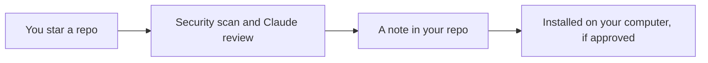

# star-triage

You star repos on GitHub. star-triage scans each one for security risks, has Claude review it,
and writes one short note per repo into a private GitHub repo of yours. Claude Code plugins,
skills, MCP servers and command-line tools you approve then install on your computer by themselves.

> [!TIP]
> **Quick start.** About 10 minutes, all in Claude Code except one terminal line for your Claude
> token. Run these three, one at a time:
>
> ```
> /plugin marketplace add thebeekeper/star-triage
> ```
>
> ```
> /plugin install star-triage@star-triage
> ```
>
> Choose **Install for you (user scope)**, then restart Claude Code.
>
> ```
> /star-triage:setup
> ```
>
> Setup asks a few questions, shows one plan, and tells you the token line. Each step in
> detail: [Install](#install).



It runs in your own GitHub Actions, every 3 hours unless you choose another interval. How it
works and why it is safe:
[docs/HOW-IT-WORKS.md](docs/HOW-IT-WORKS.md).

## Install

Do the steps in order. Every code block is one command: copy it, paste it, press Enter, then
go to the next one.

### 1. Check what you need

| You need | Check it | Get it |
| --- | --- | --- |
| Claude Code, and a Claude subscription (Pro or Max) or an Anthropic API key | `claude --version` | [claude.com/claude-code](https://claude.com/claude-code) |
| Python 3.9 or newer | Windows: `python --version`<br>Mac and Linux: `python3 --version` | [python.org](https://www.python.org/downloads/) (Windows: tick **Add python.exe to PATH**) |
| git | `git --version` | [git-scm.com](https://git-scm.com/downloads) |
| A GitHub account, and the GitHub CLI logged in to it | `gh auth status` | [cli.github.com](https://cli.github.com), then `gh auth login` |
| Node.js and uv (only for tools that come from npm or PyPI) | `node --version`, `uv --version` | [nodejs.org](https://nodejs.org), [docs.astral.sh/uv](https://docs.astral.sh/uv/) |

**You should see** a version number for each, and `gh auth status` says "Logged in to
github.com account ...". Star a few repos on GitHub now if you have none: with no stars, the
first run has nothing to review.

<details><summary>If it fails</summary>

- `python` opens the Microsoft Store, or isn't found: [Troubleshooting](docs/TROUBLESHOOTING.md#python-or-python3-is-not-found).
- `claude` isn't recognized on Windows: [Troubleshooting](docs/TROUBLESHOOTING.md#installing-claude-code-needed-once-for-the-token).

</details>

### 2. Add the marketplace

Start Claude Code (type `claude` in a terminal, or open the desktop app) and run:

```
/plugin marketplace add thebeekeper/star-triage
```

In the desktop app you can also use *Directory → Plugins → + → Add marketplace*.

**You should see** Claude Code confirm that the star-triage marketplace was added.

<details><summary>If it fails</summary>

- "not a valid GitHub owner/repo shorthand": two commands were pasted at once. Press Esc and
  paste only the line above. See [Troubleshooting](docs/TROUBLESHOOTING.md#not-a-valid-github-ownerrepo-shorthand).

</details>

### 3. Install the plugin

```
/plugin install star-triage@star-triage
```

A "Plugin Details" screen opens. It shows "By: Bee", "Components will be discovered at
installation" and a general safety warning that plugins can run code on your computer.
Choose **Install for you (user scope)**: star-triage installs your approved tools whenever
Claude Code starts, in any folder, so it must be installed for you, not for one project.

What the warning means here: each time Claude Code starts, the plugin runs a short Python
check. It installs nothing you haven't approved, and never asks for your tokens.

Then quit Claude Code and start it again, so the plugin loads.

**You should see** star-triage listed as installed when you type `/plugin`, and
`/star-triage:setup` among the suggestions when you type `/star-triage`.

<details><summary>If it fails</summary>

- `Couldn't find plugin "star-triage"`: do step 2 first. See [Troubleshooting](docs/TROUBLESHOOTING.md#the-plugin-and-the-launcher).
- Chose project or local scope by mistake: [Troubleshooting](docs/TROUBLESHOOTING.md#which-scope-do-i-pick-when-installing-the-plugin).

</details>

### 4. Run setup

Setup uses the GitHub account the GitHub CLI is logged in to: your repo, its settings and the
secret all go there. Check it is the right one (`gh auth status`) before you start. Then, in
Claude Code:

```
/star-triage:setup
```

Claude says which GitHub account it found, then asks a few questions:

- **star-triage mode:** who approves installs. `auto-plus` is recommended (see
  [What happens next](#what-happens-next)). You can change it any time.
- **Repos per run:** 8, 5 or 3. Every repo you have starred is reviewed, this many per run.
- **Data repo:** create a new private repo (`my-stars`), or use one you already have.
- **Obsidian:** whether you read your notes in [Obsidian](https://obsidian.md). It's optional.
- **How often should GitHub check for new stars?** Every 1, 3 (recommended), 6, 12 or 24 hours.
- **How long should a reviewed tool wait before it installs by itself?** Only in the auto
  modes: no wait, 1 hour (recommended), 6 or 24 hours.

Both timers can be changed later: see [The two timers](#the-two-timers).

It then shows one plan and asks once. Answer yes and it does this:

| What | Where you can check or undo it |
| --- | --- |
| Creates the private repo `<you>/my-stars` in `Documents/my-stars` (or clones the repo you picked) | GitHub, and that folder |
| Turns on GitHub Actions for it, and **Allow GitHub Actions to create and approve pull requests** (each run puts its notes in a pull request) | the repo's *Settings → Actions → General → Workflow permissions* |
| Sets how often GitHub checks for new stars (the `cron` line) | `.github/workflows/star-triage.yml` in your repo |
| Links your computer to the repo, and adds the `star-triage.py` launcher | `~/.claude/star-triage.json` and `~/.claude/star-triage.py` (`~` is your user folder) |
| Turns on Claude Code's auto-update for the star-triage marketplace | `autoUpdate` in `~/.claude/settings.json` (backup: `settings.json.bak`) |

Then it asks you for the token (step 5).

**You should see** a summary of what was done and "Not stored yet" for the Claude token.

<details><summary>If it fails</summary>

- "The GitHub CLI is not installed" or "not logged in": run `gh auth login` in a terminal,
  then `/star-triage:setup` again.
- Wrong GitHub account: `gh auth login` (or `gh auth switch`) to the right one, then run setup again.
- Anything else: [Troubleshooting, setup](docs/TROUBLESHOOTING.md#setup-script). Setup is safe to run again.

</details>

### 5. Store your Claude token

This is the one step outside Claude Code: `claude setup-token` prints your token, and it must
never pass through Claude. Open a **new terminal window** (PowerShell on Windows, Terminal on
Mac), not the Claude Code chat, and run:

<table>
<tr><th>Windows (PowerShell)</th><th>Mac and Linux</th></tr>
<tr><td>

```
python "$HOME/.claude/star-triage.py" token
```

</td><td>

```
python3 "$HOME/.claude/star-triage.py" token
```

</td></tr>
</table>

It opens your browser to log in to Claude, then prints a long token. Copy it and paste it at
the hidden prompt (nothing shows while you paste); it goes straight to GitHub as the secret
`CLAUDE_CODE_OAUTH_TOKEN`. Say yes when it offers to clear the screen. Using an Anthropic API
key instead of a subscription? Add ` --api-key` to the command.

**Never share that window:** no screenshots, no pasting it into a chat. Anyone with the token
can use your Claude subscription. If it was shared, run the same command again: it asks
"Replace it?", and you store a new token. Then revoke the old one (see
[Claude token was shared](docs/TROUBLESHOOTING.md#claude-token-was-shared)).

Before anything else it shows the GitHub account and the repo the secret goes to, and asks
"Right account?". If not, answer `n` and switch with `gh auth switch`. Use a terminal logged in to
the same GitHub account as setup (`gh auth status` shows it).

**You should see** "Secret saved." and then "Done. Go back to Claude Code and say so". The secret
is listed in your repo under *Settings → Secrets and variables → Actions*.

<details><summary>If it fails</summary>

- "only runs in your own terminal": you ran it inside Claude Code. Use a separate terminal window.
- `claude` isn't recognized: [Troubleshooting](docs/TROUBLESHOOTING.md#installing-claude-code-needed-once-for-the-token).

</details>

### 6. The first run

Go back to Claude Code and say you're done. Claude checks the secret is there (by name only)
and starts the first run, with up to 3 of your newest stars, so you see results in a few
minutes. Later runs take "repos per run".

The run may take a minute to appear: GitHub can say "Workflow run was successfully requested"
while the list still says there are no runs. Refresh the page after a few seconds.

**You should see** a green run under your repo's **Actions** tab, then a pull request with one
note per reviewed repo. Whether it merges itself depends on your mode: see the last column of
the table in [What happens next](#what-happens-next).

<details><summary>If it fails</summary>

- "workflow not found" or "hasn't registered": wait a minute, then on GitHub click
  *Actions → star-triage → Run workflow*. See [Troubleshooting, GitHub Actions](docs/TROUBLESHOOTING.md#github-actions).
- A red run: its page says why. Check your setup with `/star-triage:setup` (it is safe to run again).

</details>

## What happens next

1. **First run:** up to 3 repos are reviewed (step 6), so you see results in a few minutes.
2. **Every 3 hours** (or the interval you chose): the next repos you starred are reviewed,
   newest first, "repos per run" at a time, until all of them are done. After that, only new
   stars.
3. **A pull request per run** holds the new notes. Whether it merges itself depends on your
   mode (last column below). Until you merge one that waits, later runs add to it.
4. **Notes reach your computer** when Claude Code starts: the plugin pulls your repo.
5. **Installs happen when Claude Code starts**, for everything approved. In the auto modes
   only once the review is 1 hour old (or the wait you chose). The start message says what was
   installed and what waits until when.

### The two timers

| Timer | Default | Where it is set | Change it |
| --- | --- | --- | --- |
| **How often reviews run:** GitHub checks for new stars. A check with nothing new stops before Claude runs: no Claude usage, about a minute of GitHub Actions time. | every 3 hours (1, 3, 6, 12 or 24) | the `cron` line in `.github/workflows/star-triage.yml` (`check_every_hours` in `config.yml` keeps the same number) | `/star-triage:schedule`, or in a terminal in your repo folder: `python star-triage.py schedule --check-every 1` |
| **How long installs wait** (auto modes only): a reviewed tool installs by itself this long after its review, the next time Claude Code starts. Time to untick it or pause. | 1 hour (0 = no wait, 1, 6 or 24) | `auto_wait_hours` in `config.yml` | `/star-triage:schedule`, or `python star-triage.py schedule --install-wait 0`. Just once, now: `/star-triage:sync now` |

`python star-triage.py schedule` with no option shows both and asks. It commits and pushes the
change. (`python3` on Mac and Linux.)

### Modes

Your **star-triage mode** decides what installs without you. Change it with `/star-triage:mode`.

| Mode | Installs by itself | Waits for you | The run's pull request |
| --- | --- | --- | --- |
| `auto-plus` (recommended) | **Low and Medium** risk, any verdict except Skip and Not now | Skip and Not now verdicts: tick `approve` if you want one | Merges itself unless it approves an install above Medium risk; then it waits for you |
| `auto` | **Low** risk, any verdict except Skip and Not now | Medium risk: the verdict Install installs once you merge the pull request; others when you tick `approve` | Merges itself unless it approves an install above Low risk; then it waits for you |
| `manual` | Nothing on its own. The verdict **Install** installs once you merge the pull request | Everything else: tick `approve` | Merges itself when it only adds notes. If it approves installs, it waits for you: merging it approves them |

- **High risk and blocked items never install by themselves**, in any mode. Blocked means the
  scan found something serious (or bundled binaries); you can still install it from a terminal
  by typing `install` to confirm.
- **In the auto modes** an item waits after its review (see [The two timers](#the-two-timers)),
  and at most 5 install per day (`auto_daily_limit`). The wait is your chance to stop one.

## Daily use

Two kinds of commands. **Claude Code commands** (`/star-triage:...`, or plain words like
"approve owner/name") work in the Claude Code chat, from any folder. **Terminal commands**
(`python star-triage.py ...`) go in a terminal window, not the chat, opened in your repo folder
(`Documents/my-stars`). On Mac and Linux, write `python3` instead of `python`.

### Just starred something? Review and install it now

**Claude Code:** `/star-triage:now`, or say "check my stars now" or "install my new stars now".
It starts the review on GitHub (the security scan, then Claude, as on the schedule), waits for it
(usually 2 to 5 minutes, with a progress line every 20 seconds), then installs what is approved
without the safety delay. If the review PR waits for you, it shows what merging approves and asks
first; it never merges without your yes. It ends with a short summary: how many repos were
reviewed, what was installed, and what waits for you and why.

| In a terminal, in your repo folder | Command |
| --- | --- |
| Review new stars and install what's safe, now | `python star-triage.py now` |
| The same, at most N repos | `python star-triage.py now --max N` |
| Review some repos again | `python star-triage.py now --retriage owner/name,owner/name` |

`now` skips only the waiting. The daily limit, pause, and the High-risk and blocked rules stay. In
manual mode only what you ticked (and Install verdicts in a review PR you merged) installs; `now`
lists the notes waiting for a tick. Needs the GitHub CLI, logged in (`gh auth login`).

### Read your notes

Each note says what the repo is, whether it lives up to its claims, how risky it is (with
file and line), when you'd use it, and a verdict: Install, Try, When needed, Optional,
Portfolio only, Not now or Skip.

- **With Obsidian** (1.9 or newer): open your repo folder (`Documents/my-stars`) as a vault, then
  `tracker/Star Triage.base` for the Inbox, Installs and other views.
- **Without Obsidian:** `/star-triage:list` in Claude Code shows a table of your reviews and
  what each one is waiting for. Ask "tell me about owner/name" for one in full.
- **On GitHub:** the `tracker/` folder of your repo.

### Approve or stop one install

- **Claude Code:** say "approve owner/name" or "don't install owner/name" (the `/star-triage:list`
  skill does it). "What is waiting for me?" lists what needs you.
- **Obsidian:** tick `approve` on the note to install it; untick it to stop or remove it.
- **In a terminal, in your repo folder:** the commands below. They change the note on this
  computer, like the checkbox. Commit and push the note to keep the change on GitHub.

| In a terminal, in your repo folder | Command |
| --- | --- |
| Approve | `python star-triage.py approve owner/name` |
| Stop or remove | `python star-triage.py unapprove owner/name` |
| What waits for you | `python star-triage.py list --waiting` |

`list`, `approve` and `unapprove` fetch the latest reviews first (`git pull`). If that fails
they use the notes on your computer and say so.

A pull request that waits for you also approves: read its notes (the *Install plan* and
*Security scan* sections say what would be installed and why), then merge it.

### Installs

Installs happen by themselves when Claude Code starts (in the auto modes once the wait is
over). Skills work at once; plugins and MCP servers load the next time Claude Code starts.

- **Claude Code:** `/star-triage:sync` installs what's approved now; `/star-triage:sync now`
  also skips the wait. `now` skips only the wait: the daily limit, pause, and the High-risk and
  blocked rules stay.

| In a terminal, in your repo folder | Command |
| --- | --- |
| Install what's approved now | `python star-triage.py sync` |
| The same, without the wait | `python star-triage.py sync --now` |
| Preview, change nothing | `python star-triage.py sync --dry-run` |
| What's installed and what waits | `python star-triage.py sync --status` |

**Check:** `claude plugin list` for plugins, `claude mcp list` for MCP servers. Restart Claude
Code to load new plugins and MCP servers.

### Change the mode or the timers, pause, undo

- **Claude Code:** `/star-triage:mode`, or say "pause star-triage", "undo what star-triage
  installed". `/star-triage:schedule`, or say "check every hour", "install right away from now on".

| In a terminal, in your repo folder | Command |
| --- | --- |
| Show or change the mode | `python star-triage.py mode` |
| Show or change the two timers | `python star-triage.py schedule` |
| Stop everything automatic on this computer | `python star-triage.py pause` |
| Start it again | `python star-triage.py resume` |
| Remove the last automatic batch | `python star-triage.py undo` |
| The last 20 automatic installs and removals | `python star-triage.py history` |

`mode auto-plus` (or `auto`, `manual`) switches without the menu; it changes `mode` in
`config.yml`, commits and pushes. `schedule --check-every N` and `--install-wait N` do the same
for the timers. `undo` asks before it removes anything, so run it in a terminal.

## Updating

- **The GitHub Action** updates itself: your workflow uses `thebeekeper/star-triage@v1`.
- **The plugin** updates itself too. When your reviews come from a newer star-triage, it updates
  in the background when Claude Code starts (at most once a day) and asks you to restart Claude
  Code. Setup also turns on Claude Code's own auto-update for it. `auto_update: false` in
  `config.yml` turns both off.

To update the plugin by hand, run these in a terminal, one at a time, then restart Claude Code:

```
claude plugin marketplace update star-triage
```

```
claude plugin update star-triage@star-triage
```

<details><summary>Stop or uninstall everything</summary>

Run the commands in your repo folder (`python3` instead of `python` on Mac and Linux), in this order.

1. **Stop the reviews:** on GitHub, *Actions → star-triage → ⋯ → Disable workflow* (or
   `gh workflow disable star-triage.yml`). `gh workflow enable star-triage.yml` turns it back on.
2. **Remove what it installed:** `python star-triage.py sync --status` lists it; remove each with
   `python star-triage.py sync --uninstall NAME`. Do this before step 3: the launcher needs the plugin.
3. **Remove the plugin**, in a terminal: `claude plugin uninstall star-triage@star-triage`, then
   `claude plugin marketplace remove star-triage`. If reviewed plugins were installed, also
   `claude plugin marketplace remove my-stars` (your `marketplace_name`). Then delete
   `~/.claude/star-triage.json` and `~/.claude/star-triage.py`.
4. **Remove your Claude token from GitHub:** *Settings → Secrets and variables → Actions*, or
   `gh secret delete CLAUDE_CODE_OAUTH_TOKEN` (or `ANTHROPIC_API_KEY`).
5. **Delete your notes, if you want:** delete the repo on GitHub (*Settings → Danger Zone*) and
   its folder. Your stars are not touched.

</details>

## Reference

### Commands

Run them in your repo folder: `python star-triage.py <command>` on Windows,
`python3 star-triage.py <command>` on Mac and Linux. `python star-triage.py` alone lists them.

| Command | What it does | In Claude Code |
| --- | --- | --- |
| `now` | Review the stars you just added on GitHub, wait, ask before merging, install what's safe (`--max N`, `--retriage owner/name,...`) | `/star-triage:now` |
| `sync` | Install, update or remove what you approved | `/star-triage:sync` |
| `sync --now` | The same, without the wait of the auto modes | `/star-triage:sync now` |
| `sync --dry-run` | Show what `sync` would do; change nothing | |
| `sync --status` | Everything installable, and its state on this computer | |
| `sync --uninstall NAME` | Remove one item and untick its note | |
| `list` | Your reviews, newest first (`--waiting`, `--repo owner/name`) | `/star-triage:list` |
| `approve owner/name` | Approve an install, like ticking `approve` | "approve owner/name" |
| `unapprove owner/name` | Untick it; an installed item is removed | "don't install owner/name" |
| `mode` | Show or change the mode (`mode auto-plus`, `auto`, `manual`) | `/star-triage:mode` |
| `schedule` | Show or change the two timers (`--check-every 1\|3\|6\|12\|24`, `--install-wait 0\|1\|6\|24`) | `/star-triage:schedule` |
| `pause`, `resume` | Stop or restart everything automatic on this computer | `/star-triage:mode` |
| `undo` | Remove the last automatic batch and untick those notes | `/star-triage:mode` |
| `history` | The last 20 automatic installs and removals, with the reason | `/star-triage:mode` |
| `doctor` | Check your setup and say how to fix what is wrong | `/star-triage:setup` |
| `setup` | Guided setup in the terminal; safe to run again | `/star-triage:setup` |
| `token` | Store your Claude token as a GitHub secret (your own terminal only) | |

### Settings (`config.yml` in your repo)

Edit, commit and push. The next run uses the new values.

| Key | Default | What it does |
| --- | --- | --- |
| `mode` | your answer in setup | `manual`, `auto` or `auto-plus` (see [What happens next](#what-happens-next)); missing means `manual` |
| `max_per_run` | `8` | Repos reviewed per run (the first run always takes 3) |
| `check_every_hours` | `3` | How often GitHub checks for new stars. Mirrors the workflow's `cron` line: change both with `schedule --check-every` |
| `model` | `sonnet` | Claude model for reviews: `sonnet`, `opus` or `haiku` |
| `auto_wait_hours` | `1` | Auto modes: hours after a review before it installs (`0` = no wait); `schedule --install-wait` |
| `auto_daily_limit` | `5` | Auto modes: most automatic installs per day on one computer |
| `obsidian` | your answer in setup | `false` skips the Obsidian tips |
| `auto_update` | `true` | `false` stops the plugin updating itself |
| `ignore` | `[]` | Repos never to review (`owner/name`) |
| `github_user` | your repo's owner | Whose stars to read |
| `contexts` | `General` | Optional: your projects, each becomes a `relevant_to` label |
| `marketplace_name` | `my-stars` | Name of the list of reviewed plugins |
| `install_scope` | `user` | Scope for reviewed plugins: `user`, `project` or `local` |
| `labels` | | The label values notes may use |

How often reviews run is the `cron` line in `.github/workflows/star-triage.yml`; change it with
`python star-triage.py schedule`, which keeps `check_every_hours` the same. To review repos
again, run the workflow on GitHub with **retriage** set to `owner/name` (comma separated).

## More

- [Troubleshooting](docs/TROUBLESHOOTING.md): every problem people have hit, with the fix.
- [How it works](docs/HOW-IT-WORKS.md): the security model, cost, files, setting up by hand, FAQ.
- [Features](docs/FEATURES.md) and [Changelog](CHANGELOG.md).

## License

MIT. Made by Bee ([@thebeekeper](https://github.com/thebeekeper)).
