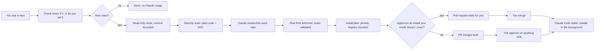

# How star-triage works

The detail behind the [README](../README.md): what happens to a star, why it is safe, what it
costs, where everything lives, and how to set it up by hand. Problems and fixes are in
[Troubleshooting](TROUBLESHOOTING.md); every design choice is in [Features](FEATURES.md).

## From star to install

Every GitHub user has a pile of starred repos they never looked at again. star-triage runs in
your own GitHub Actions. Within a few hours of a new star it:

1. scans the repo with plain code for security risks (hooks, install scripts, hidden
   downloads, obfuscation, vulnerable dependencies and more),
2. has Claude Code research it: README, code, the scan's findings and independent reviews,
3. writes one labelled note per repo and adds it to your tracker, and
4. works out exactly how to install it, whatever it is: a Claude Code **plugin**, **skills**,
   an **MCP server** or a **command-line tool**, pinned to the reviewed commit or to a
   package version that is checked to really come from that repo.

Approved installs then happen **on your computer by themselves**: when Claude Code starts, a
quick background check installs anything new. You approve by merging the review PR, by ticking
the `approve` box on a note in Obsidian, or with `python star-triage.py approve owner/name`.
Untick it and it is removed again. Or use the `auto` or `auto-plus` star-triage mode and items
within its risk limit approve themselves.

### What a note answers

- What is it, really, under the marketing?
- Does it live up to its claims ("70% fewer tokens", "10x faster")?
- How risky is it to install, with the evidence (file and line)?
- When would you use it? Two or three concrete examples ("When you'd use it").
- Verdict: Install, Try, When needed, Optional, Portfolio only, Not now or Skip.

Reviews judge each repo on general quality and safety, not on who you are. Projects you list
under `contexts` in `config.yml` are optional and become `relevant_to` labels; an older
`about_me` key still works as extra context.

The notes are plain Markdown with properties at the top, so the `tracker/` folder works as an
**Obsidian vault** (1.9 or newer, for Bases) and reads fine on GitHub. In Obsidian, open your
clone (or just `tracker/`) as a vault, then `tracker/Star Triage.base` for the Inbox, All repos,
Try next, Installs and Cards views. To see new notes without `git pull`, install the community
plugin **Git** (by Vinzent) and set *Auto pull interval* to 10 minutes. Triage a note by
changing its `status` from `Inbox` to `Reviewing`, `Try next`, `Using`, `Later` or `Skipped`.

**Highlights:** installs plugins, skills, MCP servers and CLI tools by themselves · a scanner
the AI can't argue with · a risk floor Claude can raise but never lower · nothing from a
starred repo runs during review · every install pinned and checked against its repo ·
approve with a merge, a checkbox or a command · runs entirely in your own GitHub.

### When something installs

An item is **approved** when nothing blocks it, its risk is not High, and either the verdict
is Install or your star-triage mode covers its risk (`auto`: Low, `auto-plus`: Low and Medium)
and the verdict is not Skip or Not now. Anything else that can be installed is **available**:
tick `approve` on its note (or `approve owner/name`) to install it.

The run's pull request merges itself unless it newly approves an install outside your mode's
risk limit (in `manual`, any newly approved install). A config with no `mode` line is
`manual`; an old config with `auto_merge: never` and no `mode` always waits.

On your computer, the plugin's start-up hook pulls your repo (at most every 5 minutes) and
installs everything approved:

- `manual`: at once, when Claude Code starts.
- `auto` and `auto-plus`: once the review is `auto_wait_hours` old (1 in configs made since
  5.5.0; 6 when the line is missing), at most `auto_daily_limit` (5) a day. High-risk items
  are never installed in the background; run `sync` yourself for them.
- **Blocked** items (high-severity scan findings, bundled binaries, unknown commit) never
  install in the background in any mode. `sync` in your own terminal asks you to type
  `install` to confirm one.
- `sync --now` installs what is approved without the safety delay. The daily limit, pause and
  the High-risk and blocked rules stay. It is recorded in the history, so `undo` covers it.
- Skills work straight away; plugins and MCP servers load the next time Claude Code starts.
  The start message says what was installed, what waits and until when (local time).

Every automatic action goes to `.star-triage/history.jsonl` (read by `history` and `undo`) and
everything sync does to `.star-triage/sync.log`, in your data repo.

### What it can't install

Libraries you add to a project, apps, Docker images and tools with custom installers
(`curl ... | sh`). Their notes say "install by hand", with the command. An MCP server that
needs an API key is listed with the exact command to add it with your key.

## Security model

This workflow points an AI agent at code written by strangers, and can lead to installing
that code, so it is locked down in layers:

- **Nothing from a starred repo is executed.** Repos are shallow-cloned with hooks,
  submodules and LFS disabled, symlinks stored as plain files, `.git` removed and large files
  dropped.
- **Plain-code security scan first.** Hooks, MCP servers, install scripts, `curl | sh`, writes to
  Claude or agent config, permission bypasses, obfuscated code, binaries, prompt-injection
  text and known-vulnerable dependencies (OSV-Scanner, pinned version, checksum verified).
  The scan sets a **risk floor**: Claude can raise a note's risk but never lower it.
- **Claude gets no shell.** It can only read, search, browse the web and write notes. `Bash`
  and `Edit` are blocked. Instructions found inside a repo are treated as data, and a README
  that tries to instruct an AI agent is flagged as a risk.
- **Claude's workspace can't change decisions.** Scan results are copied out of Claude's reach
  before it starts and every later step reads that copy. The code that runs after Claude isn't
  in your repo at all (it comes from the Action), and anything changed outside `tracker/`
  during the Claude step (config, installs.json, the plugin list) is reverted before the next step.
- **The GitHub token is kept out of reach** while Claude runs: `persist-credentials: false`, and
  a credential helper instead of a token in `.git/config`. The step after Claude restores
  `.git/config` and warns if a token ever appears in a URL there.
- **A validator gates every run.** Only new notes for that run's repos, with valid labels and a
  risk at or above the scan's floor, are accepted.
- **Claude proposes, code decides.** Claude only suggests how to install a repo. Plain code
  checks it: plugins and skills come from the reviewed commit; an npm or PyPI package must
  link back to that exact repo on its registry page (renames are followed by GitHub ID) and
  is pinned to a version; a hosted MCP URL must appear in the repo itself; a one-time setup
  command must appear word for word in the README and can't be a shell, `curl`, `sudo` or
  an interpreter; arguments are plain words only.
- **Strict approval.** See [When something installs](#when-something-installs). High-severity
  findings or bundled binaries block an item: it is never installed in the background, and
  installing it by hand means typing `install` to confirm.
- **Your keys stay yours.** Setup never shows your Claude token to an AI: the `token` command
  runs only in a real terminal, and the token goes from `claude setup-token` to GitHub's hidden
  prompt. An MCP server that needs an API key is never configured with one automatically.
- **You stay in control.** A PR that approves installs outside your mode waits for your merge,
  every item has an `approve` checkbox, sync never passes `--yes`, and every action is logged.
- **Auto modes have brakes.** The default is `manual`. In `auto` and `auto-plus` an item waits
  a safety delay after its review, at most 5 install per day, High-risk and blocked items
  never install by themselves, `pause` stops everything on a computer, `undo` removes the last
  batch, and `history` shows what happened and why. Only your own `sync --now` skips the delay.
- **Claude Code's settings are touched in one place.** Setup sets the documented `autoUpdate`
  field on the existing star-triage marketplace entry in `~/.claude/settings.json` (backup:
  `settings.json.bak`), and nothing else. `auto_update: false` turns it off.

No setup is perfectly safe against a determined attacker, and an approved tool runs with your
permissions. Read the PR before merging, especially the Install plan and Security scan sections.

## Cost

- **Claude:** each new repo is a short research session on your subscription or API key.
  Sonnet is the default (`model` in `config.yml`). Checks with no new stars use no Claude usage.
- **Your backlog:** every repo you starred before setup is reviewed too, newest first,
  `max_per_run` per run (default 8) every 3 hours, so up to 64 reviews a day until it has
  caught up (the first run takes 3, so you see results in a few minutes). With 200 stars that
  is about three days. Checking every hour (`schedule --check-every 1`) catches up faster and
  uses about 720 Actions minutes a month, within the 2,000 free for private repos. To go
  slower, lower `max_per_run`. To
  leave repos out, list them under `ignore` in `config.yml`. To pause, disable the workflow.
- **GitHub Actions:** free for public repos. A private repo uses about 240 minutes a month for
  the 3-hourly checks, inside the 2,000 free minutes of GitHub's free plan. Change the `cron`
  line in `.github/workflows/star-triage.yml` to check more or less often.

## How it fits together

- **The engine** (this repo) is a GitHub Action (the cloud side) and a Claude Code plugin (the
  computer side), sharing one copy of the code. Action fixes reach your workflow by
  themselves through `@v1`. The plugin updates itself when your reviews come from a newer
  version (`auto_update`), or with `claude plugin update star-triage@star-triage`.
- **Your data repo** is tiny: `config.yml`, your `tracker/` notes, `installs.json`, a launcher
  (`star-triage.py`) and a 20-line workflow that calls `thebeekeper/star-triage@v1`. It never
  holds engine code.
- **The link** between them on your computer: `~/.claude/star-triage.json` (which data repo, and
  where the plugin's code is; written by setup and on every Claude Code start) and
  `~/.claude/star-triage.py` (a launcher that works from any folder and survives updates).

### Files

**The engine:**

| Path | What it does |
| --- | --- |
| `action.yml` | The GitHub Action your data repo's workflow calls |
| `.claude-plugin/`, `hooks/`, `skills/` | The Claude Code plugin: marketplace, start-up hook, `/star-triage:setup`, `:sync`, `:list`, `:mode`, `:triage` |
| `prompts/triage.md` | The instructions Claude follows |
| `scripts/export_stars.py`, `select_new.py`, `clone_new.py` | Find new stars and clone them safely |
| `scripts/scan_repo.py` | The plain-code security scanner |
| `scripts/apply_scan.py`, `validate_notes.py` | Merge the scan into notes, enforce the risk floor, check every note |
| `scripts/queue_installs.py` | Work out each install (plugin, skill, MCP, CLI), check and pin it, approve or block it |
| `scripts/publish.py` | Open the review PR (or add to the open one) and merge it when allowed |
| `scripts/sync.py` | Install, update and remove approved items on your computer; pause, resume, undo, history; plugin self-update |
| `scripts/reviews.py` | `list`, `approve`, `unapprove`: the reviews without Obsidian |
| `scripts/mode.py` | Show or switch the mode (manual, auto, auto-plus) |
| `scripts/setup.py`, `doctor.py` | Setup (from the chat or the terminal), the `token` step, migration, and a check that says what is wrong and how to fix it |
| `scripts/paths.py` | Finds the engine and your data repo |
| `template/` | The skeleton of a new data repo |
| `tests/` | How changes are checked (see `tests/README.md`) |

**Your data repo:**

| Path | What it does |
| --- | --- |
| `config.yml` | Mode, limits, label values, install settings, optional projects |
| `tracker/` | Your notes, the Obsidian base and a note template |
| `installs.json` | Every reviewed install, pinned, with its approval (written by the workflow) |
| `.claude-plugin/marketplace.json` | Reviewed plugins, pinned, for Claude Code's plugin installer |
| `star-triage.py` | The launcher for every command in the README |
| `.github/workflows/star-triage.yml` | Runs every 3 hours (its `cron` line; `star-triage.py schedule` changes it) and calls the Action |
| `.star-triage/` | On your computer only: `sync.log`, `history.jsonl`, the pause flag |

## Set up by hand

`/star-triage:setup` does all of this. To do it yourself:

1. Create a new private repo on GitHub and copy everything from this repo's `template/` folder
   into it (including `template/.github/`). In `config.yml`, pick a `mode`; listing your
   projects under `contexts` is optional.
2. Add a Claude credential as a repository secret
   (*Settings → Secrets and variables → Actions → New repository secret*):
   `CLAUDE_CODE_OAUTH_TOKEN` (run `claude setup-token`; uses your Claude subscription; it
   prints the token, so don't share that window) or `ANTHROPIC_API_KEY`.
3. *Settings → Actions → General → Workflow permissions* → tick **Allow GitHub Actions to
   create and approve pull requests** → Save.
4. *Actions → star-triage → Run workflow*, set "Max repos" to `2`. (In a brand-new repo GitHub
   sometimes doesn't list the workflow; `python star-triage.py setup --repair` fixes that.)
5. Install the plugin (README steps 2 and 3) and, in your data repo's folder, run
   `python star-triage.py setup --skip-config` once (`python3` on Mac and Linux) to link it.

Setup also runs in a terminal, asking its questions there:
`python "$HOME/.claude/star-triage.py" setup` (`python3` on Mac and Linux). Add
`--step-by-step` to be asked before each step, or `--check` to only check.

## Upgrading from v4

A v4 copy has its own `scripts/` folder. Install the plugin, then in Claude Code run
`/star-triage:setup`: it sees the old layout and gives you the command
(`python star-triage.py setup --migrate`). It removes the copied code, swaps in the small
workflow and the launcher, and keeps your config, notes, `installs.json` and approvals.
Nothing you installed is reinstalled.

## Run the triage on your computer

Open your data repo in Claude Code, make sure `gh` is logged in (or `GITHUB_TOKEN` is set) and
PyYAML is installed, then type `/star-triage:triage`. Same pipeline; you commit the notes
yourself.

## FAQ

**Can it see my star lists?** It tries. GitHub's API doesn't always expose lists; when it
does, list names are used as category hints. Stars themselves are always public.

**Why not trigger instantly when I star something?** GitHub has no event for starring someone
else's repo, so star-triage checks every 3 hours instead (every 1 to 24 hours, your choice:
`star-triage.py schedule --check-every N`).

**Will it review the same repo twice?** No. A repo with a note in `tracker/` is skipped,
matched by its URL. To review one again, run the workflow with **retriage** set to its
`owner/name` (comma separated for several). Your status and approve choices are kept. A note
you wrote by hand never went through the scan, so it can't be installed until it is reviewed
this way; `retriage: starter` reviews every such note.

**What if I leave a PR unmerged for a week?** Nothing piles up. Later runs add their notes to
that same PR, and repos already waiting in it are not reviewed again.

**Why is something waiting for me?** In `manual` mode only Install verdicts are approved when
you merge. In the auto modes, anything above your mode's risk limit, or with the verdict Skip
or Not now, waits. `python star-triage.py list --waiting` lists them.

**Why wasn't something with an Install verdict approved?** The PR and the note's Install plan
say why: usually a high-risk scan finding, bundled binaries, a package that doesn't link back
to the repo, or High risk.

**Notion?** Not built in. Notion can import the Markdown notes.
